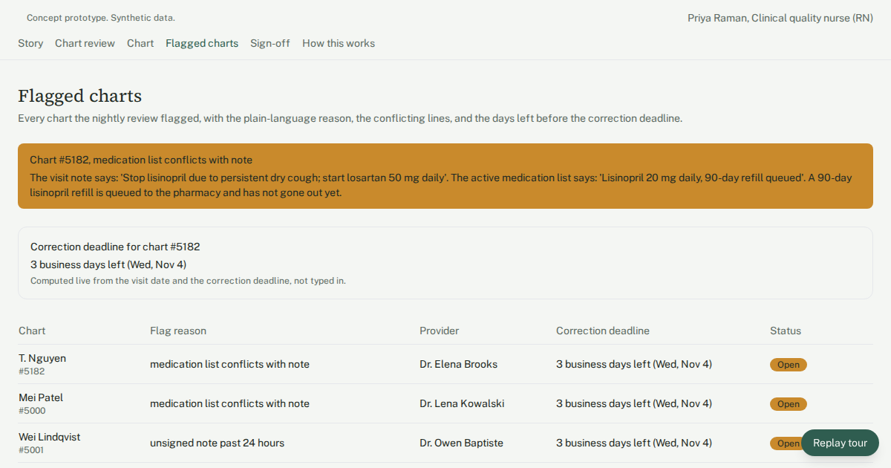

# Daily chart review flags for an 8-provider family medicine group

Every chart from recent visits gets a first-pass review. Documentation gaps are flagged with a reason, and nothing goes to billing until staff approve the fix.

## Who has this problem

Primary care groups with several providers and locations, where one quality nurse checks charts by hand each morning. The practice in this demo is fictional: 8 providers, 3 locations, about 100 patient visits per business day.

The nurse opens a random sample of yesterday's charts, checks each one against a paper checklist, logs problems in a shared spreadsheet and emails the providers. Out of 104 charts, there is time for about 35. That takes about 11 hours a week and still misses about 65% of charts. Charts that aren't sampled go to billing and pharmacy refills unchecked. The billing team estimates $8,500 a month in claims returned or downcoded because of documentation gaps found after submission. Corrections live in email, so nobody can see what's overdue or which gaps keep coming back.

## What the demo shows

1. **Meet Priya.** The Story screen introduces the clinical quality nurse and shows her morning before and after the tool.
2. **Every chart, not a sample.** The Chart review screen lists every chart from the last three business days (300 synthetic charts) with provider, location, visit type, review status and any flag reason. You can filter by provider or show flagged charts only.
3. **One history per chart.** Opening chart #5182 shows the visit summary, the review findings, and every note and status change in order. Staff can add a timestamped note.
4. **A conflict, caught the next morning.** On Flagged charts, #5182 is at the top with the reason "medication list conflicts with note". The note line "Stop lisinopril due to persistent dry cough; start losartan 50 mg daily" sits next to the medication list line "Lisinopril 20 mg daily, 90-day refill queued". The queued refill is named.
5. **The deadline is on screen.** A live countdown to the correction deadline is worked out from the visit date (visit date plus 3 business days), not typed in. From here the nurse attaches the provider's addendum and moves the chart to sign-off.
6. **Priya still decides.** Correction sign-off shows the proposed change: remove lisinopril 20 mg, add losartan 50 mg, cancel the queued refill. The chart isn't updated and nothing goes to billing until she clicks "Approve and release".
7. **The numbers that matter.** Four metrics on the review screen, computed from the chart data: charts reviewed yesterday, flag rate, open flags past deadline, and average hours to resolve a flag.
8. **How this would be built.** The architecture screen shows the real system this prototype stands for.

## How it's built

- A browser-only React + TypeScript + Tailwind app built on the Umakes kit.
- Synthetic seed data: 300 charts across 8 fictional providers and 3 locations, about 24 flagged across 5 plain-language reasons, plus chart timeline events.
- Built and checked by the Umakes App Factory: automated gates, plus a reviewer that uses the app and clicks through every screen and tour step.
- The "How this would work" architecture screen maps the production design: the practice's existing EMR, the chart review app, Claude for review, the quality nurse, the treating provider, and the EMR billing queue.

## What a production version adds

- **EMR integration.** A nightly job reads closed encounters, notes and medication lists from the practice's existing EMR. Approved corrections are written back to the EMR, and charts are released to the EMR billing queue only after staff approval.
- **AI review under a BAA.** Only the note sections each check needs are sent to Claude, and only under a signed BAA. Flags are suggestions; no chart, medication list or refill changes without staff approval.
- **HIPAA controls.** Role-based access for clinical quality staff and providers, audit logs for every view and action, encryption at rest and in transit, and BAAs with every vendor that touches PHI.
- **Deployment and ownership.** It runs on the client's own cloud (GCP), and the client owns the code and the data.

## Try it

Live demo: https://umakescloud-max.github.io/emr-chart-review-flags-v1/

This is a concept prototype built on synthetic data. No real patients, providers or practices are in it. A real build runs on the client's own cloud, HIPAA-ready, and the client owns it.

If your team fights this every week, book a free workflow audit at umakes.cloud or reply to umakescloud@gmail.com.
